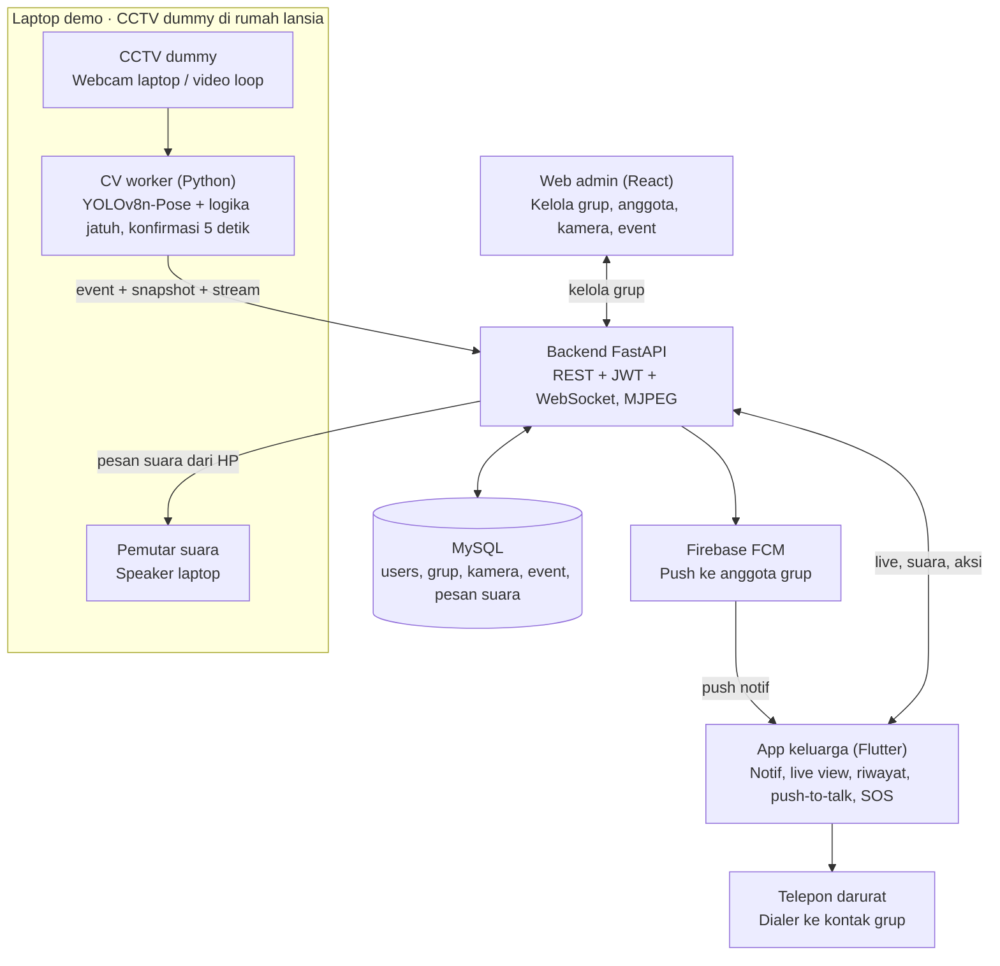
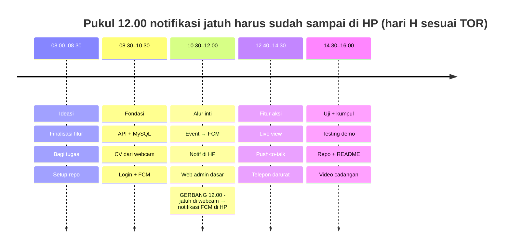

# SIGAP: Sistem Deteksi Jatuh pada Lansia Berbasis Computer Vision Menggunakan CCTV dengan Notifikasi Real-Time kepada Keluarga

Product Requirements Document (PRD) · 3 November 2026 · Amir

## 1. Ringkasan Produk

SIGAP adalah aplikasi mobile Flutter untuk keluarga dan website admin React yang mengubah CCTV (dalam demo: CCTV dummy) menjadi pendeteksi jatuh lansia, lalu mengirim notifikasi FCM ke HP Android keluarga dalam hitungan detik.

| Item | Keterangan |
| --- | --- |
| Nama produk | SIGAP |
| Judul lengkap | Sistem Deteksi Jatuh pada Lansia Berbasis Computer Vision Menggunakan CCTV dengan Notifikasi Real-Time kepada Keluarga |
| One-liner | Lansia jatuh, keluarga langsung tahu dan langsung bertindak. |
| Kompetisi | Mini Hackathon Offline MAKE IT FEST III, HIMATIF Universitas Samudra |
| Tema | HACK THE REAL WORLD, subtema Lansia |
| Bentuk produk | Aplikasi mobile Android (Flutter) untuk keluarga + website admin (React); CCTV dummy sebagai prototype pendukung demo |
| Status | Rencana pengembangan; seluruh kode dibangun saat hari lomba |

Nilai utama SIGAP: deteksi otomatis tanpa alat di badan lansia, keluarga terhubung dalam satu grup, dan dari HP keluarga bisa melihat kondisi, berbicara lewat speaker CCTV, serta menelepon darurat dengan satu tombol.

## 2. Latar Belakang dan Masalah

Masalah utama yang diselesaikan SIGAP adalah keterlambatan pertolongan: lansia yang jatuh saat sendirian sering baru ditemukan setelah lama tergeletak.

**Skala masalah**

- Jatuh adalah penyebab kematian akibat cedera tidak disengaja nomor dua di dunia, dengan sekitar 684.000 kematian per tahun. Lansia di atas 60 tahun mengalami jatuh fatal terbanyak ([WHO](https://who.int/news-room/fact-sheets/detail/falls)).
- Lebih dari 80% kematian akibat jatuh terjadi di negara berpenghasilan rendah dan menengah, dan kawasan Pasifik Barat serta Asia Tenggara menyumbang 60% di antaranya ([WHO](https://who.int/news-room/fact-sheets/detail/falls)).
- Indonesia sedang menua: sekitar 34 juta lansia atau 11,97% penduduk pada 2025 ([RRI, data BPS](https://rri.co.id/bandar-lampung/berita-lain/2486908/bps-indonesia-resmi-masuki-kategori-aging-population)), diproyeksikan 20,31% pada 2045 ([DDTCNews, data BPS](https://news.ddtc.co.id/berita/nasional/1814840/dapur-ddtcnews-oktober-2025-kupas-tuntas-pensiun-dan-aspek-pajaknya)).

**Kondisi di lapangan**

- Banyak lansia tinggal sendiri atau ditinggal keluarga yang bekerja di siang hari.
- Lansia yang jatuh sering tidak mampu bangun atau meraih ponsel untuk meminta tolong.
- Keluarga tidak bisa memantau CCTV terus-menerus; rekaman baru dilihat setelah kejadian.

**Celah solusi yang ada**

| Solusi | Kelemahan |
| --- | --- |
| Wearable / smartwatch deteksi jatuh | Mahal, harus dipakai dan diisi daya, sering lupa dipakai lansia |
| Tombol darurat (panic button) | Tidak berguna jika lansia pingsan atau tidak bisa bergerak |
| CCTV biasa | Hanya merekam, tidak memberi peringatan otomatis |
| Pengasuh/perawat 24 jam | Biaya tinggi, tidak terjangkau sebagian besar keluarga |

SIGAP mengisi celah ini dengan deteksi pasif: lansia tidak perlu melakukan apa pun, dan CCTV yang sudah ada menjadi sumber datanya.

## 3. Kesesuaian dengan TOR

SIGAP disusun mengikuti TOR Mini Hackathon MAKE IT FEST III: produk berupa aplikasi mobile dan website, dibangun selama hari lomba 08.00–16.00 WIB, dan didemokan dalam 15 menit.

| Ketentuan TOR | Cara SIGAP memenuhinya |
| --- | --- |
| Produk berupa website atau aplikasi mobile (F.5, G.5) | Aplikasi mobile Flutter untuk keluarga + website React untuk admin. CCTV dummy hanya prototype pendukung demo, yang diizinkan di F.5 |
| Produk dikembangkan selama lomba, bukan produk jadi (J.1–2, P.1) | Sebelum lomba hanya PRD, desain alur, dan latihan. Seluruh kode ditulis di hari H dan tercatat di riwayat commit GitHub |
| Tema ditentukan lewat undian setelah briefing (G.3) | PRD ini persiapan untuk subtema Lansia, karena daftar tema diumumkan lebih dulu. Jika undian memberi tema lain, tim menyusun ulang ide di sesi ideasi |
| Tim 3–5 orang, semua berkontribusi (C.3, J.7) | Peran dibagi untuk 5 orang dan bisa digabung untuk tim 3–4 orang (bagian 13) |
| Bebas memilih teknologi, wajib patuh lisensi (H) | Flutter, React, FastAPI, MySQL, Firebase, OpenCV, YOLOv8/MediaPipe. Ultralytics YOLOv8 berlisensi AGPL-3.0 (aman untuk repo terbuka); alternatifnya MediaPipe (Apache 2.0) |
| AI hanya alat bantu, tim wajib paham produk (I) | Setiap anggota menguasai bagiannya dan alur sistem secara utuh; jawaban untuk pertanyaan juri disiapkan (bagian 14) |
| Wajib menunjukkan proses pengembangan (J.4) | Commit kecil dan sering sepanjang hari oleh semua anggota |
| Pengumpulan: file project, repo, dokumentasi singkat, link demo (G.7) | Repo GitHub monorepo, README + PRD ini sebagai dokumentasi, file APK, dan link video demo |
| Presentasi 10 menit + 5 menit tanya jawab oleh semua anggota (M) | Struktur pitch di bagian 14 mengikuti materi minimal TOR |

**Strategi per aspek penilaian (TOR N)**

| Aspek | Bobot | Strategi SIGAP |
| --- | --- | --- |
| Kreativitas dan Inovasi | 25% | Computer vision dari CCTV yang sudah ada, grup keluarga, bicara ke lansia lewat speaker CCTV, telepon darurat satu tombol |
| Fungsionalitas Produk | 25% | Alur inti jatuh → notifikasi FCM → aksi keluarga benar-benar berjalan live saat demo |
| Kesesuaian dengan Tema | 20% | Masalah nyata lansia jatuh saat sendirian, didukung data WHO dan BPS |
| UI/UX dan Usability | 15% | Notifikasi jelas dalam 3 detik, tombol SOS besar, aksi utama maksimal 2 ketukan dari notifikasi |
| Presentasi dan Demo | 15% | Demo jatuh live di atas matras, semua anggota berbicara, video cadangan siap |

Jika nilai sama, TOR mengutamakan fungsionalitas produk (O.2). Karena itu alur inti selalu didahulukan sebelum fitur tambahan.

## 4. Tujuan dan Metrik Keberhasilan

Target MVP: jatuh terdeteksi dengan recall minimal 90% pada uji simulasi, dan notifikasi FCM sampai ke HP keluarga kurang dari 10 detik setelah kejadian.

**Tujuan produk**

1. Mendeteksi kejadian jatuh secara otomatis dari video CCTV tanpa alat tambahan di tubuh lansia.
2. Mengirim notifikasi push (FCM) beserta snapshot ke semua anggota grup keluarga.
3. Memberi keluarga aksi cepat dari HP: melihat live view, mengirim suara ke speaker CCTV, dan menelepon kontak darurat.
4. Menekan alarm palsu agar keluarga tetap percaya pada notifikasi.
5. Menjaga privasi lansia dengan meminimalkan penyimpanan video.

**Metrik keberhasilan MVP**

| Metrik | Definisi | Target MVP |
| --- | --- | --- |
| Recall (sensitivitas) | Persentase kejadian jatuh yang terdeteksi pada video simulasi tim | ≥ 90% |
| Precision | Persentase notifikasi yang benar-benar kejadian jatuh | ≥ 85% |
| Latensi deteksi | Waktu dari jatuh sampai event terkonfirmasi (termasuk timer 5 detik) | ≤ 6 detik |
| Latensi notifikasi | Waktu dari event terkonfirmasi sampai notifikasi FCM muncul di HP | ≤ 4 detik |
| Kecepatan proses | Frame per detik yang diproses CV worker di CPU laptop | ≥ 15 FPS |
| Alarm palsu saat demo | Notifikasi pada skenario non-jatuh (duduk cepat, rebahan di kasur) | 0 |
| Kecepatan aksi | Ketukan dari notifikasi sampai dialer telepon darurat terbuka | ≤ 2 |

Angka di atas adalah target uji pada video simulasi tim dan skenario demo, bukan klaim performa di dunia nyata.

## 5. Pengguna dan Peran

SIGAP punya tiga peran: lansia yang dipantau secara pasif, keluarga sebagai pengguna aplikasi mobile, dan admin yang mengelola grup lewat website.

| Peran | Platform | Yang bisa dilakukan | Contoh persona |
| --- | --- | --- | --- |
| Lansia | Tidak memakai aplikasi; terpantau CCTV | Tidak perlu melakukan apa pun | Eyang Sri, 72 th, tinggal sendiri, kurang akrab dengan gawai |
| Keluarga (akun biasa) | Aplikasi Flutter (Android) | Daftar dan masuk, gabung grup dengan kode undangan, terima notifikasi, lihat live view dan riwayat, kirim suara, telepon darurat, tandai sudah ditangani | Rina, 38 th, anak yang bekerja dan tinggal 30 menit dari rumah ibunya |
| Admin | Website React | Buat grup keluarga, daftarkan kamera, undang dan keluarkan anggota, atur kontak darurat, pantau semua event | Kepala keluarga, atau pengelola panti wreda yang mengawasi banyak kamar |

Satu grup keluarga mewakili satu rumah atau satu lansia. Satu akun keluarga bisa bergabung ke lebih dari satu grup, dan hanya anggota grup yang menerima notifikasi serta bisa membuka kamera grup tersebut.

## 6. User Stories dan Alur Pengguna

Alur inti SIGAP: admin menyiapkan grup, kamera mendeteksi jatuh, keluarga menerima notifikasi, lalu keluarga bertindak langsung dari HP.

**User stories**

| ID | Sebagai | Saya ingin | Agar | Prioritas |
| --- | --- | --- | --- | --- |
| US-01 | Keluarga | menerima notifikasi push di HP saat lansia jatuh, meski aplikasi tertutup | saya bisa segera bertindak | Wajib |
| US-02 | Keluarga | melihat snapshot, waktu, dan ruangan kejadian | saya bisa memastikan apakah benar-benar jatuh | Wajib |
| US-03 | Keluarga | menekan satu tombol untuk menelepon kontak darurat | pertolongan datang secepatnya | Wajib |
| US-04 | Keluarga | menandai kejadian "Sudah ditangani" | anggota keluarga lain tahu situasi sudah diurus | Wajib |
| US-05 | Keluarga | melihat live view kamera dari HP | saya tahu kondisi terkini lansia | Wajib |
| US-06 | Keluarga | bergabung ke grup keluarga dengan kode undangan | saya menerima informasi lansia yang saya jaga | Wajib |
| US-07 | Keluarga | merekam pesan suara yang diputar di speaker CCTV | lansia tenang dan tahu bantuan sedang datang | Sebaiknya |
| US-08 | Keluarga | melihat riwayat kejadian | saya bisa membahasnya dengan dokter | Sebaiknya |
| US-09 | Admin | membuat grup, mendaftarkan kamera, dan mengelola anggota di web | hanya orang yang tepat yang menerima informasi | Wajib |
| US-10 | Admin | melihat daftar event semua kamera beserta statusnya | saya tahu kejadian mana yang belum ditangani | Sebaiknya |
| US-11 | Lansia | tidak perlu memakai alat atau menekan tombol apa pun | saya tetap nyaman beraktivitas | Wajib |

**Alur utama (happy path)**

1. Admin membuat grup "Rumah Eyang Sri" di web, mendaftarkan kamera ruang tamu, mengisi kontak darurat, dan membagikan kode undangan.
2. Keluarga mendaftar di aplikasi, memasukkan kode undangan, dan token FCM HP-nya tersimpan di backend.
3. CCTV dummy (webcam laptop) mengirim frame ke CV worker, yang mendeteksi pose dan pola jatuh.
4. Jika orang tetap di lantai 5 detik, CV worker mengirim event + snapshot ke backend.
5. Backend menyimpan event di MySQL dan mengirim notifikasi FCM ke semua anggota grup.
6. Keluarga membuka notifikasi, melihat snapshot dan live view, lalu memilih aksi: telepon darurat, kirim suara, atau tandai ditangani.
7. Status event berubah; anggota lain mendapat pembaruan dan admin melihatnya di dasbor web.
8. Jika 2 menit belum ada respons, backend mengirim notifikasi ulang (maksimal 3 kali).

## 7. Ruang Lingkup

Waktu pengerjaan di hari lomba hanya sekitar 7 jam 20 menit, jadi MVP fokus pada alur inti jatuh → notifikasi FCM → aksi keluarga; sisanya masuk pengembangan lanjutan.

| Fitur | MVP (hari lomba) | Pengembangan lanjutan |
| --- | --- | --- |
| Sumber video | CCTV dummy: webcam laptop atau video loop | CCTV IP asli via RTSP, multi-kamera |
| Deteksi jatuh | YOLOv8n-Pose atau MediaPipe + aturan | Model temporal (LSTM/ST-GCN) yang dilatih ulang |
| Notifikasi | FCM ke Android, prioritas tinggi | iOS, SMS, panggilan otomatis |
| Grup keluarga | Admin membuat grup, keluarga gabung dengan kode undangan | Peran bertingkat, undangan lewat tautan |
| Live view | Stream MJPEG dari laptop demo | Streaming WebRTC berlatensi rendah |
| Kirim suara ke CCTV | Push-to-talk: rekam pesan suara di HP, diputar di speaker laptop | Intercom dua arah real-time |
| Telepon darurat | Tombol SOS membuka dialer HP ke kontak darurat grup | Panggilan berantai otomatis ke beberapa kontak |
| Tandai ditangani / alarm palsu | Ya | Catatan tindak lanjut per kejadian |
| Web admin | Kelola grup, anggota, kamera, daftar event | Analitik dan laporan mingguan |
| Privasi snapshot | Wajah diblur | Mode skeleton penuh |

**Di luar cakupan**

- Diagnosis medis atau penilaian tingkat cedera.
- Integrasi resmi dengan layanan 112/ambulans; tombol SOS hanya membuka dialer ke nomor yang diatur admin.
- Pemasangan CCTV fisik dan aplikasi iOS.

## 8. Kebutuhan Fungsional

Kebutuhan fungsional dibagi ke enam modul: akun dan grup, kamera, deteksi, notifikasi, aksi keluarga, dan web admin.

| ID | Modul | Kebutuhan | Kriteria Penerimaan |
| --- | --- | --- | --- |
| FR-01 | Akun | Keluarga dan admin dapat daftar dan masuk dengan email + password (JWT) | Token valid; peran admin dan keluarga dibedakan |
| FR-02 | Grup | Admin membuat grup, mengisi nama lansia dan kontak darurat, lalu sistem membuat kode undangan 6 karakter | Kode unik tampil di web admin |
| FR-03 | Grup | Keluarga bergabung dengan kode undangan; admin dapat mengeluarkan anggota | Anggota muncul atau hilang dari daftar grup |
| FR-04 | Kamera | Admin mendaftarkan kamera dummy ke grup (nama ruangan, sumber webcam/video) | Kamera tampil berstatus online saat CV worker berjalan |
| FR-05 | Deteksi | CV worker membaca frame, mendeteksi 17 keypoints, dan mengenali jatuh dari laju turun, sudut tubuh, dan rasio bounding box | Recall ≥ 90% pada video simulasi tim |
| FR-06 | Deteksi | Event dibuat hanya jika orang tetap di lantai 5 detik dan tidak berada di zona abaikan (kasur/sofa) | Duduk cepat dan rebahan di kasur tidak memicu event |
| FR-07 | Notifikasi | Backend menyimpan event + snapshot, lalu mengirim FCM ke token semua anggota grup | Notifikasi muncul ≤ 4 detik, termasuk saat aplikasi di background atau tertutup |
| FR-08 | Notifikasi | Notifikasi ulang tiap 2 menit jika event belum ditangani | Maksimal 3 kali per event |
| FR-09 | Aksi keluarga | Halaman detail event menampilkan snapshot, waktu, ruangan, serta tombol Telepon darurat, Kirim suara, Sudah ditangani, dan Alarm palsu | Terbuka langsung saat notifikasi diketuk |
| FR-10 | Aksi keluarga | Tombol Telepon darurat membuka dialer HP dengan nomor kontak darurat grup | ≤ 2 ketukan dari notifikasi |
| FR-11 | Aksi keluarga | Live view menampilkan stream kamera di HP | Jeda < 3 detik di jaringan lokal |
| FR-12 | Aksi keluarga | Push-to-talk: tahan tombol untuk merekam, lepas untuk mengirim; audio diputar di speaker CCTV dummy | Suara terdengar ≤ 5 detik setelah dikirim |
| FR-13 | Aksi keluarga | Status Sudah ditangani / Alarm palsu tersimpan dan diberitahukan ke anggota lain | Nama penanggap tampil di app dan web |
| FR-14 | Web admin | Dasbor menampilkan grup, anggota, kamera, dan daftar event dengan status real-time | Event baru muncul tanpa refresh (WebSocket) |
| FR-15 | Riwayat | Riwayat event di app dan web dapat difilter tanggal dan status | Data sesuai isi MySQL |

## 9. Kebutuhan Non-Fungsional

SIGAP harus cepat, tetap bisa didemokan saat jaringan venue bermasalah, dan tidak menyimpan video dari dalam rumah.

| ID | Kategori | Kebutuhan |
| --- | --- | --- |
| NFR-01 | Performa | CV worker ≥ 15 FPS di CPU laptop (model nano, input 640 px) |
| NFR-02 | Latensi | Total waktu jatuh sampai notifikasi muncul di HP ≤ 10 detik |
| NFR-03 | Notifikasi | FCM dikirim prioritas tinggi dengan channel notifikasi khusus agar muncul heads-up dan berbunyi |
| NFR-04 | Jaringan | Backend, CV worker, HP, dan web berada di satu jaringan lokal; FCM butuh internet, jadi siapkan hotspot HP cadangan |
| NFR-05 | Keamanan | Password di-hash (bcrypt), endpoint grup hanya untuk anggotanya, kredensial Firebase dan MySQL di file .env, tidak di-commit |
| NFR-06 | Privasi | Video tidak disimpan; hanya snapshot event (wajah diblur) dan pesan suara, dihapus otomatis setelah 30 hari |
| NFR-07 | Usability | Tombol SOS besar dan kontras, teks Bahasa Indonesia, aksi utama ≤ 2 ketukan |
| NFR-08 | Keandalan demo | Mode input video file sebagai cadangan jika webcam bermasalah |
| NFR-09 | Maintainability | Monorepo terstruktur (/mobile, /web, /backend, /cv-worker) dengan README cara menjalankan |

## 10. Arsitektur Sistem dan Tech Stack

SIGAP terdiri dari lima bagian: CCTV dummy + CV worker di laptop demo, backend FastAPI dengan MySQL, Firebase Cloud Messaging, aplikasi Flutter untuk keluarga, dan web admin React.

CV worker adalah inti sistem: ia memutuskan kapan terjadi jatuh, lalu backend meneruskannya ke HP keluarga lewat FCM dan ke web admin lewat WebSocket. Arah sebaliknya, pesan suara dari HP diteruskan backend ke speaker CCTV dummy.

**Logika deteksi jatuh (titik awal, ambang disetel saat uji)**

1. Laju turun: titik tengah pinggul turun cepat, misalnya lebih dari 0,5 kali tinggi badan per detik.
2. Sudut tubuh: garis bahu–pinggul miring lebih dari 60° dari posisi tegak.
3. Bentuk tubuh: rasio lebar terhadap tinggi bounding box lebih dari 1,2.
4. State machine: Normal → Kemungkinan jatuh → tetap di lantai ≥ 5 detik → Jatuh terkonfirmasi. Jika orang bangun sebelum timer habis, status kembali Normal.
5. Zona abaikan: jika posisi berbaring berada di area kasur/sofa, event tidak dibuat.

**Tech stack**

| Lapisan | Teknologi | Peran |
| --- | --- | --- |
| Aplikasi keluarga | Flutter (Android): firebase_messaging, flutter_local_notifications, url_launcher, record, dio | Notifikasi, live view, push-to-talk, telepon darurat |
| Web admin | React + Vite, Tailwind CSS, axios | Kelola grup, anggota, kamera, dan event |
| Backend | FastAPI (Python), SQLAlchemy, JWT, firebase-admin SDK, WebSocket | REST API, kirim FCM, stream MJPEG, terima audio |
| Database | MySQL 8 | Data akun, grup, kamera, event, pesan suara |
| Notifikasi | Firebase Cloud Messaging (FCM) | Push notifikasi ke Android, gratis |
| CV worker | Python, OpenCV, Ultralytics YOLOv8n-Pose (alternatif MediaPipe Pose) | Deteksi pose dan logika jatuh |
| CCTV dummy | Webcam laptop atau video loop + speaker laptop | Sumber video dan pemutar pesan suara |
| Version control | Git + GitHub (monorepo) | Bukti proses pengembangan saat lomba (TOR J.4) |

**Model data (MySQL)**

| Tabel | Kolom utama |
| --- | --- |
| users | id, nama, email, password_hash, role (admin/keluarga), fcm_token |
| family_groups | id, nama_grup, nama_lansia, kode_undangan, kontak_darurat, admin_id |
| group_members | group_id, user_id, joined_at |
| cameras | id, group_id, nama_ruangan, sumber, status |
| events | id, camera_id, waktu, snapshot_path, status (baru/ditangani/alarm_palsu), handled_by |
| voice_messages | id, camera_id, user_id, file_path, played_at |

**Endpoint utama (FastAPI)**

| Endpoint | Fungsi |
| --- | --- |
| POST /auth/register, POST /auth/login | Membuat akun dan mendapatkan token JWT |
| POST /groups, POST /groups/join | Membuat grup (admin), bergabung dengan kode undangan (keluarga) |
| POST /devices/fcm-token | Menyimpan token FCM HP keluarga |
| POST /events | Dipanggil CV worker: simpan event + snapshot, lalu kirim FCM ke anggota grup |
| PATCH /events/{id} | Mengubah status menjadi ditangani atau alarm palsu |
| GET /cameras/{id}/stream | Live view MJPEG untuk aplikasi dan web |
| POST /cameras/{id}/voice | Upload pesan suara; diteruskan ke CV worker lewat WebSocket untuk diputar |
| WS /ws/groups/{id} | Pembaruan event real-time untuk web admin dan aplikasi |

## 11. Privasi, Etika, dan Keamanan Data

Kamera di dalam rumah menyangkut martabat lansia, jadi SIGAP dirancang dengan prinsip privacy by design dan memproses data seminimal mungkin.

- **Persetujuan (consent):** lansia dan keluarga menyetujui pemasangan dan cara kerja sistem sebelum aktif. Lansia diberi penjelasan sederhana kamera mana yang dipantau.
- **Pemrosesan lokal:** video diproses di perangkat rumah; tidak ada streaming video ke cloud pada mode default.
- **Minimisasi data:** yang disimpan hanya metadata event (waktu, kamera, status) dan satu snapshot per event.
- **Mode skeleton:** snapshot dapat diganti gambar kerangka tubuh atau wajah diburamkan, sehingga keluarga tahu kejadiannya tanpa melihat detail tubuh.
- **Zona privat:** kamera tidak dianjurkan dipasang di kamar mandi; area tertentu bisa di-mask sepenuhnya.
- **Retensi:** snapshot dihapus otomatis setelah 30 hari (dapat diatur).
- **Kontrol akses:** hanya anggota grup yang menerima notifikasi dan bisa membuka live view; aplikasi dan web admin memakai login.
- **Kepatuhan:** pengelolaan data mengacu pada prinsip UU No. 27 Tahun 2022 tentang Pelindungan Data Pribadi, karena gambar wajah dan data kesehatan termasuk data pribadi.

## 12. Risiko dan Mitigasi

Risiko terbesar di hari lomba adalah waktu yang sempit dan jaringan venue; keduanya ditangani dengan gerbang pukul 12.00 dan rencana cadangan demo.

| Risiko | Dampak | Mitigasi |
| --- | --- | --- |
| Waktu 7 jam 20 menit terlalu sempit untuk 4 komponen | Fitur inti tidak selesai | Gerbang pukul 12.00 untuk alur inti; push-to-talk dan fitur admin lanjutan dipotong jika terlambat; boilerplate resmi (flutter create, create-vite) boleh dipakai sesuai TOR J.3 |
| Internet venue lambat atau putus | Notifikasi FCM tidak muncul saat demo | Hotspot HP cadangan; event juga dikirim lewat WebSocket saat aplikasi terbuka; video demo cadangan |
| Setup Firebase dan FCM memakan waktu | Notifikasi tertunda | Satu orang fokus; uji kirim dari Firebase Console dulu sebelum integrasi ke backend |
| Alarm palsu (duduk cepat, membungkuk, rebahan di lantai) | Keluarga mengabaikan notifikasi | Timer konfirmasi 5 detik, zona abaikan, tombol Alarm palsu |
| Izin mikrofon atau format audio bermasalah | Push-to-talk gagal | Rekam AAC/M4A, uji izin di awal; fitur berprioritas Sebaiknya sehingga bisa dipotong |
| Cahaya dan sudut webcam di venue | Akurasi pose turun | Laptop diletakkan lebih tinggi, latih sudut sebelum demo, mode input video file sebagai cadangan |
| Laptop lambat | Latensi tinggi | Model nano, proses tiap frame ke-2, resolusi input 640 px |
| Juri menilai produk sudah jadi atau sepenuhnya dibuat AI (TOR I, P.1) | Pengurangan nilai atau diskualifikasi | Commit bertahap oleh semua anggota sepanjang hari; setiap anggota bisa menjelaskan kodenya |

Catatan keselamatan: semua simulasi jatuh untuk pengujian dan demo dilakukan di atas matras oleh anggota tim, bukan oleh lansia.

## 13. Timeline dan Pembagian Peran

Jadwal mengikuti TOR: pengerjaan pukul 08.00–12.00 dan 12.40–16.00 WIB, sehingga alur inti jatuh → notifikasi harus sudah berjalan sebelum ishoma.

Jika gerbang 12.00 belum tercapai, push-to-talk dan fitur admin lanjutan dipotong, dan seluruh tim menstabilkan alur inti. Setelah 16.00, tim memakai 15 menit persiapan pra-demonstrasi untuk cek jaringan, baterai HP, dan posisi webcam.

**Batas persiapan sebelum hari H:** PRD, desain alur dan wireframe, latihan teknologi, pembuatan akun GitHub/Firebase, serta rekaman video simulasi jatuh untuk pengujian. Kode produk tidak ditulis sebelum lomba (TOR J.1–2); jika ragu soal batas ini, konfirmasikan ke panitia.

**Pembagian peran (5 orang)**

| Peran | Tanggung jawab | Bagian presentasi |
| --- | --- | --- |
| Ketua + CV Engineer | CV worker, logika jatuh, CCTV dummy, pemutar suara | Teknologi deteksi |
| Backend Engineer | FastAPI, MySQL, FCM, stream MJPEG, upload audio, WebSocket | Alur sistem dan arsitektur |
| Mobile Developer | Flutter: login, gabung grup, notifikasi, live view, SOS, push-to-talk | Demo aplikasi keluarga |
| Frontend Developer | React: dasbor admin, grup, anggota, kamera, event | Demo web admin |
| Product & QA | Skenario uji, UI/UX, README, slide, video cadangan | Pembukaan masalah dan penutup |

Untuk tim 3–4 orang, gabungkan Frontend dengan Product & QA, lalu CV Engineer dengan Backend Engineer.

## 14. Rencana Demo dan Presentasi

Sesuai TOR, setiap tim mendapat 15 menit: 10 menit presentasi dan demo, lalu 5 menit tanya jawab, dibawakan oleh semua anggota.

**Struktur presentasi 10 menit (materi minimal TOR M.3)**

| Menit | Materi | Pembicara |
| --- | --- | --- |
| 0:00–1:00 | Permasalahan: lansia jatuh saat sendirian, data WHO dan BPS | Product & QA |
| 1:00–2:00 | Ide solusi dan target pengguna (lansia, keluarga, admin) | Ketua |
| 2:00–3:00 | Fitur utama dan teknologi yang digunakan (diagram arsitektur) | Backend + CV |
| 3:00–7:30 | Demo produk live | Mobile, Frontend, CV |
| 7:30–8:45 | Keunggulan produk | Ketua |
| 8:45–10:00 | Potensi pengembangan dan model bisnis | Product & QA |

**Skenario demo (± 4,5 menit)**

1. Buka web admin: tunjukkan grup "Rumah Eyang Sri", kamera ruang tamu, dan anggota keluarga. Layar HP ditampilkan ke proyektor (misalnya dengan scrcpy).
2. Anggota tim duduk cepat di kursi, lalu rebahan di area kasur: tidak ada notifikasi.
3. Anggota tim jatuh di atas matras dan diam: dalam beberapa detik HP berbunyi dengan notifikasi FCM.
4. Ketuk notifikasi: tampil snapshot, lalu buka live view.
5. Tahan tombol push-to-talk dan ucapkan "Bu, tunggu ya, kami segera datang": suara keluar dari speaker laptop.
6. Tekan Telepon darurat: dialer terbuka ke nomor kontak darurat (gunakan nomor anggota tim).
7. Tekan Sudah ditangani: status berubah di web admin secara real-time.

**Cadangan jika demo live gagal:** video demo 60–90 detik yang direkam saat sesi uji, dan mode input video file.

**Persiapan tanya jawab (TOR I.4)**

| Kemungkinan pertanyaan juri | Inti jawaban |
| --- | --- |
| Kenapa pose estimation, bukan deteksi objek biasa? | Keypoints menunjukkan posisi dan sudut tubuh, sehingga bisa membedakan jatuh dari duduk atau membungkuk |
| Bagaimana mencegah alarm palsu? | Timer konfirmasi 5 detik, zona abaikan, dan tombol Alarm palsu sebagai umpan balik |
| Kenapa FCM? | Gratis, resmi untuk Android, dan notifikasi tetap masuk walau aplikasi tertutup |
| Bagaimana privasi lansia dijaga? | Video tidak disimpan, wajah di snapshot diblur, hanya anggota grup yang punya akses |
| Bagian mana yang dibantu AI? | Jawab jujur (brainstorming, debugging, potongan kode) dan tunjukkan riwayat commit tim |
| Bagaimana jika dipakai sungguhan? | Ganti CCTV dummy dengan CCTV IP via RTSP tanpa mengubah backend dan aplikasi |

**Keunggulan yang ditekankan:** tanpa alat di tubuh lansia, memakai CCTV yang sudah ada, satu grup untuk seluruh keluarga, dan aksi langsung dari HP (lihat, bicara, telepon).
