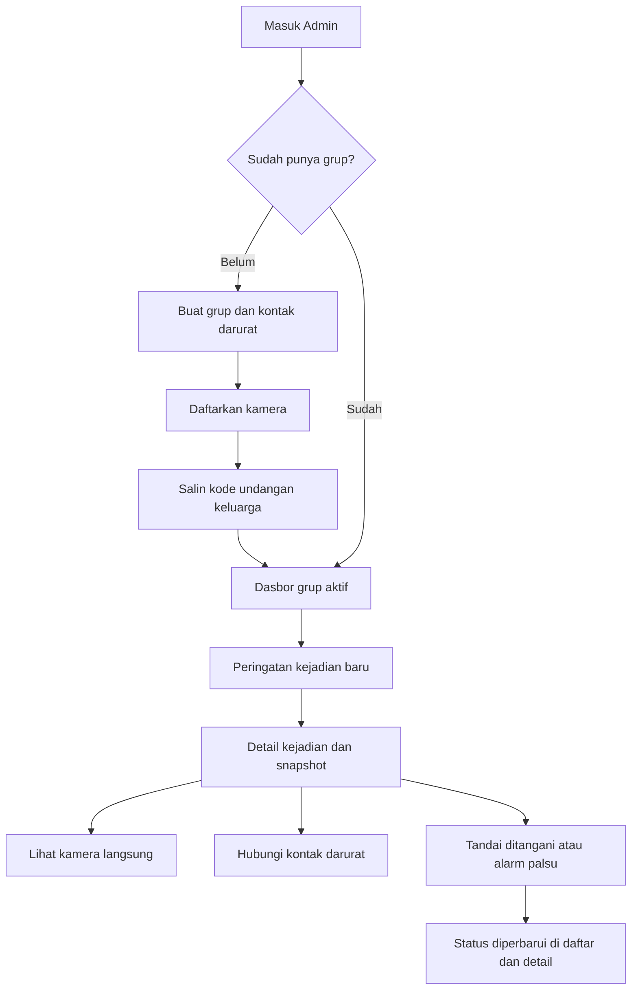

# Rancangan UI Web Admin SIGAP

Tanggal: 3 November 2026  
Fokus: website admin React + Vite + Tailwind CSS  
Status: spesifikasi desain untuk implementasi bertahap

Dokumen ini menjadi panduan mengerjakan UI web SIGAP: struktur halaman, wireframe, sistem visual, interaksi, dan kondisi layar. Pengguna utamanya adalah admin keluarga atau pengelola panti. Semua nama, kode undangan, dan angka pada wireframe merupakan contoh data demo.

## 1. Acuan dan keputusan desain

| Acuan lokal | Digunakan untuk |
| --- | --- |
| [PRD SIGAP](PRD_SIGAP.md), terutama bagian 5–9 | Peran admin, pengelolaan grup/kamera/anggota, kejadian, dan pembaruan langsung |
| [Referensi UI SIGAP](Referensi_UI_SIGAP.md), terutama bagian 3–7 | Pola sidebar, kartu ringkasan, grid kamera, daftar kejadian, dan animasi |
| [Panduan warna](colour.md) | Warna komponen, hierarki peringatan, dan label status |
| [Paket branding](sigap-branding.zip) dan [pratinjau branding](sigap-branding-preview.png) | Logo, wordmark, simbol, dan favicon |
| [Paket ilustrasi](<sigap-ilustrasi (1).zip>) dan [pratinjau ilustrasi](sigap-ilustrasi-preview.png) | Ilustrasi login, grup kosong, kamera offline, dan riwayat kosong |
| [UI web saat ini](../web/src/pages/DashboardPage.jsx) dan [kontrak data](../backend/app/schemas.py) | Menyesuaikan rancangan dengan fitur serta data yang sudah tersedia |

**Keputusan utama:**

1. **Teal untuk kontrol UI, biru asli untuk aset merek.** `colour.md` menjadi acuan tombol, sidebar, fokus, dan status. Navy `#003480` serta biru `#2F9AF8` pada logo/ilustrasi dipertahankan. Penyebutan biru sebagai warna tema di dokumen referensi tidak mengganti token UI teal.
2. **Light mode sebagai tampilan utama.** Permukaan terang, teks gelap, border tipis, dan ruang antarkomponen cukup lebar untuk demo di proyektor.
3. **Peringatan lebih penting daripada statistik.** Admin harus segera melihat kejadian yang belum ditangani dan dapat membuka detailnya dengan satu klik.
4. **Satu grup aktif sebagai konteks utama.** Dasbor, kamera, kejadian, dan anggota mengikuti pilihan grup yang sama. Daftar Grup Keluarga menampilkan semua grup yang dapat diakses akun.
5. **Status harus faktual.** “Kamera online” menunjukkan koneksi kamera; “Tidak ada peringatan baru” menunjukkan data kejadian. Keduanya tidak berarti kondisi lansia pasti aman.
6. **Gunakan struktur dan aset yang sudah ada.** React, Tailwind, dan ikon `lucide-react` tetap menjadi dasar. Rancangan ini tidak memerlukan penambahan UI kit atau library animasi.

## 2. Batas fitur web

| Prioritas | Cakupan |
| --- | --- |
| P0 — inti | Masuk/daftar admin; pilih/buat grup; daftarkan kamera; kode undangan; daftar anggota dan keluarkan anggota; dasbor; daftar/detail kejadian; lihat kamera; ubah status kejadian; kontak darurat; kondisi loading, kosong, dan gagal |
| P1 — penyempurnaan setelah inti | Edit informasi grup/kontak; halaman kamera dan anggota yang lebih lengkap; filter tanggal/status; pengalaman responsif; pemulihan koneksi; panel simulasi demo |
| P2 — sesudah alur inti stabil | Ringkasan agregat semua grup, pagination riwayat penuh, animasi tambahan, statistik tren jika kebutuhan dan API sudah tersedia |

Prioritas menunjukkan urutan pengerjaan UI; beberapa fungsi P1 sudah mempunyai endpoint. Fitur P2 tidak perlu menjadi menu kosong dalam versi awal.

Perekaman/playback video, grafik kesehatan, diagnosis cedera, peta lokasi, interkom dua arah, ekspor laporan, dan pengaturan zona deteksi melalui web tidak termasuk rancangan inti. Tampilan kamera memakai live view dan snapshot kejadian yang tersedia. Aplikasi keluarga hanya disebut sebagai tujuan kode undangan, tanpa rancangan layar aplikasi.

## 3. Navigasi dan alur

### Struktur halaman

| ID | Menu / layar | Isi utama | Aksi utama |
| --- | --- | --- | --- |
| W-00 | Masuk / Daftar Admin | Logo, ilustrasi, form akun | Masuk ke dasbor |
| W-01 | Dasbor | Ringkasan grup aktif, peringatan, kamera, kejadian terbaru | Tinjau kejadian |
| W-02 | Grup Keluarga | Daftar grup yang dapat diakses, nama lansia, jumlah kamera/anggota | Buat grup / buka grup |
| W-03 | Detail Grup | Informasi grup, kontak darurat, kode undangan, pintasan pengelolaan | Salin kode / edit informasi |
| W-04 | Kamera | Grid kamera grup aktif, koneksi, tambah kamera | Lihat langsung |
| W-05 | Kejadian | Riwayat, filter, status dan penanggap | Buka detail |
| W-06 | Detail Kejadian | Snapshot, waktu, ruangan, status, kontak dan tindak lanjut | Hubungi kontak / tandai ditangani |
| W-07 | Anggota | Anggota grup aktif, peran, email, tanggal bergabung | Undang / keluarkan anggota |

Sidebar berurutan: **Dasbor → Grup Keluarga → Kamera → Kejadian → Anggota**. Profil singkat dan tombol Keluar berada di bagian bawah sidebar. Tidak perlu menu Pengaturan yang belum memiliki fungsi.

Nama halaman di atas adalah target pemisahan UI. Implementasi saat ini baru memakai `AuthPage` dan `DashboardPage`; jalur URL dan mekanisme navigasi belum menjadi kontrak aplikasi.



**Aturan konteks grup:**

- Pemilih grup berada di topbar dan selalu menyebut nama grup. Saat belum ada grup, tampilkan ajakan “Buat grup pertama”.
- Pergantian grup memperbarui kamera, anggota, kontak, daftar kejadian, dan koneksi pembaruan. Batalkan/abaikan respons lama agar data grup sebelumnya tidak muncul di grup baru.
- Detail kejadian selalu mengikuti `group_id` milik kejadian tersebut. Nomor kontak tidak boleh diambil dari grup lain yang kebetulan sedang dipilih.
- Admin dapat mengelola grup ketika `admin_id` cocok dengan ID akunnya. Grup yang hanya diikuti tetap dapat dilihat sesuai izin; kontrol edit grup, tambah/hapus kamera, dan keluarkan anggota tidak ditampilkan sebagai aksi yang tersedia.
- Versi awal hanya menjanjikan pembaruan langsung untuk grup aktif. Pemantauan serentak seluruh grup memerlukan pengelolaan koneksi dan ringkasan tambahan.

## 4. Sistem visual web

### Warna dan status

| Penggunaan | Latar / warna utama | Teks / detail |
| --- | --- | --- |
| Halaman | `#F8FAFC` | Teks utama `#0F172A` |
| Kartu, tabel, modal | `#FFFFFF` | Border `#E2E8F0` |
| Sidebar dan tombol utama | `#0F766E` | Putih; hover `#115E59` |
| Menu aktif / info grup | `#F0FDFA` | `#115E59` |
| Kejadian belum ditangani | `#FEF2F2` | `#991B1B`; garis kiri 4 px `#DC2626` |
| Tombol Hubungi kontak darurat | `#DC2626` | Putih; hover `#B91C1C` |
| Sudah ditangani | `#ECFDF5` | `#065F46`; tombol aksi `#047857` dengan teks putih |
| Peringatan koneksi / validasi | `#FFFBEB` | `#92400E`; ikon amber |
| Alarm palsu / kamera offline | `#F1F5F9` | `#334155`; border `#CBD5E1` |
| Bingkai gambar kamera | `#0F172A` | Keterangan putih pada panel terpisah |
| Teks sekunder | — | `#334155`; teks bantu `#64748B` pada putih |

Merah hanya untuk peringatan jatuh dan aksi menghubungi kontak darurat. Tombol hapus kamera, keluarkan anggota, dan simulasi menggunakan gaya netral dengan label jelas serta konfirmasi. Kesalahan form memakai ikon, teks, dan panel amber agar tidak menyerupai peringatan jatuh.

Setiap status wajib memiliki **ikon + label**, bukan titik warna saja:

| Nilai data | Label UI | Ikon yang disarankan |
| --- | --- | --- |
| `baru` | Belum ditangani | `AlertTriangle` |
| `ditangani` | Sudah ditangani | `CheckCircle2` |
| `alarm_palsu` | Alarm palsu | `CircleMinus` |
| Kamera `online` | Kamera online | `Wifi` |
| Kamera `offline` | Kamera offline | `WifiOff` |

“Memuat”, “Menyambungkan”, dan “Koneksi terputus” adalah kondisi tampilan, bukan status kejadian baru. Tidak menambah status “Sedang ditangani” karena kontrak event belum memilikinya.

### Ukuran dan tata letak

| Elemen | Spesifikasi rancangan |
| --- | --- |
| Frame desain awal | Desktop 1440 × 900 px; cek juga laptop 1280 × 720 px |
| Sidebar | Lebar 240 px; latar teal; area logo putih untuk logo asli |
| Topbar | Tinggi minimum 72 px; pemilih grup, kondisi koneksi, identitas admin |
| Konten | Padding desktop 32 px; jarak antarseksi 24 px; lebar isi maksimum 1440 px |
| Grid | 12 kolom sebagai panduan; gap 24 px; kamera 2 kolom secara default |
| Kartu | Radius 12 px; border 1 px; padding 20–24 px; bayangan sangat tipis bila perlu |
| Judul halaman | 28 px / 36 px, semibold atau bold |
| Judul seksi | 20 px / 28 px, semibold |
| Isi / input | 16 px / 24 px |
| Metadata | 14 px / 20 px; informasi penting tidak diperkecil |
| Angka ringkasan | 28–32 px, semibold, digit sejajar jika tersedia |
| Tombol / input | Tinggi minimum 44 px; tombol darurat minimum 48 px |
| Spasi | Kelipatan 4 px: 4, 8, 12, 16, 24, 32, 48 |
| Ikon | 20–24 px; ikon tanpa teks tetap memiliki nama aksesibel |
| Font | Plus Jakarta Sans variable, bobot 200–800, disajikan lokal dengan fallback sans sistem |

Target keterbacaan: kontras teks normal minimal 4,5:1 pada pasangan warna final. Amber solid `#D97706` tidak dipasangkan dengan teks putih kecil; gunakan teks gelap atau panel amber muda. Periksa hasil komponen setelah opacity, hover, dan overlay diterapkan, bukan hanya nilai token.

### Aset yang dipakai

Path di kolom kedua adalah lokasi **di dalam ZIP**, belum lokasi hasil ekstraksi.

| Kebutuhan | Aset sumber | Penempatan |
| --- | --- | --- |
| Identitas sidebar/login | `sigap-branding/logo/sigap-wordmark.svg` atau `sigap-logo.svg` | Sidebar pada bidang putih; logo lengkap di login |
| Favicon | `sigap-branding/web/favicon.svg`, `favicon.ico` | Tab browser |
| Login admin | `sigap-ilustrasi/web/login-web.svg` | Panel ilustrasi kiri |
| Grup kosong | `sigap-ilustrasi/svg/empty-belum-grup.svg` | Daftar grup dan dasbor awal |
| Riwayat kosong | `sigap-ilustrasi/svg/empty-semua-aman.svg` | Pesan “Belum ada kejadian tercatat” |
| Kamera offline | `sigap-ilustrasi/svg/empty-kamera-offline.svg` | Area media kamera |

Ilustrasi dipakai pada login dan kondisi kosong, tidak memenuhi dasbor operasional. Ukuran ilustrasi kondisi kosong sekitar 160–240 px. Teks “Semua aman hari ini” dari README aset diganti dengan kalimat faktual. Untuk hasil “Sudah ditangani”, cukup ikon centang dan pesan singkat; tidak perlu konfeti.

Saat implementasi, logo/ilustrasi dapat ditempatkan di `web/src/assets/` dan favicon di `web/public/`. Ilustrasi dekoratif memakai `alt=""`; snapshot kejadian memiliki teks alternatif yang menyebut ruangan dan waktu. Jangan memakai lembar preview sebagai gambar UI.

## 5. Wireframe halaman

### W-00 — Masuk dan daftar admin

Tujuan: admin memahami fungsi produk dan segera masuk. Layout dua kolom pada desktop, dengan form selebar maksimum 420 px.

```text
+------------------------------------+----------------------------------+
| SIGAP                              | Masuk ke SIGAP Admin             |
|                                    | Kelola pemantauan keluarga Anda. |
| [Ilustrasi login-web.svg]           |                                  |
|                                    | Email                            |
| Pantau kejadian,                    | [admin@contoh.id               ] |
| koordinasikan bantuan.             | Kata sandi                       |
|                                    | [************************  mata] |
| Kelola grup keluarga, kamera,      |                                  |
| dan tindak lanjut dalam satu       | [       Masuk ke dasbor        ] |
| tempat.                            | Belum punya akun? Daftar admin   |
+------------------------------------+----------------------------------+
```

- Daftar memakai form yang sama dengan tambahan nama lengkap; gunakan validasi panjang nama/kata sandi sesuai API.
- Label selalu terlihat. Placeholder bukan pengganti label. Ikon mata mengubah visibilitas kata sandi dan memiliki nama aksesibel.
- Saat submit: label menjadi “Memproses…”, cegah submit ganda. Jika gagal, pertahankan email dan tampilkan pesan dekat form.
- Akun keluarga yang masuk mendapat pesan bahwa web ini untuk admin, sesuai perilaku autentikasi saat ini.
- Sesi kedaluwarsa menampilkan “Sesi Anda berakhir. Silakan masuk kembali.” Kembalikan tujuan halaman setelah login jika masih berhak mengaksesnya.
- Alamat backend dan konfigurasi teknis tidak menjadi isi utama form. Detail diagnostik hanya tersedia dalam mode pengembangan.
- Pada layar sempit, form menjadi satu kolom dan ilustrasi disembunyikan atau diperkecil.

### W-01 — Dasbor grup aktif

Tujuan: admin mengetahui grup yang dipantau, kondisi koneksi, dan kejadian yang perlu ditinjau tanpa menggulir jauh.

```text
+-------------------+----------------------------------------------------------+
| [LOGO SIGAP]      | Grup: [Rumah Eyang Sri v]  Pembaruan aktif   Admin: Budi |
|                   +----------------------------------------------------------+
| > Dasbor          | Dasbor Pemantauan                        [Segarkan]     |
|   Grup Keluarga   | Eyang Sri · Rumah Eyang Sri                              |
|   Kamera          |                                                          |
|   Kejadian        | ! 2 kejadian belum ditangani*       [Tinjau kejadian]    |
|   Anggota         |                                                          |
|                   | [Kamera online] [Kejadian hari ini*] [Belum ditangani*] |
|                   | [    1 / 2    ] [        3         ] [       2        ] |
|                   |                                                          |
|                   | Kamera grup                          [Lihat semua]     |
|                   | +--------------------+ +-----------------------------+ |
|                   | | Ruang Tamu  Online | | Kamar Depan         Offline | |
|                   | | [Pratinjau kamera] | | [Ilustrasi kamera offline]  | |
|                   | | [Lihat langsung]   | | [Coba lagi]                 | |
|                   | +--------------------+ +-----------------------------+ |
|                   |                                                          |
|                   | Kejadian terbaru                    [Semua kejadian]   |
|                   | Snapshot | Waktu | Ruangan | Status | Aksi             |
|                   | [gambar] | 10.42 | R. Tamu | Baru   | [Lihat detail]    |
|                   | [gambar] | 09.15 | R. Tamu | Selesai| [Lihat detail]    |
| Budi · Admin      |                                                          |
| [Keluar]          | *Contoh angka; cakupan data dijelaskan di bawah.        |
+-------------------+----------------------------------------------------------+
```

Label status pada UI final tetap menggunakan label lengkap dari bagian 4; singkatan di wireframe hanya untuk ruang teks.

**Isi dan perilaku:**

- Banner peringatan berada sebelum kartu ringkasan. Tombol “Tinjau kejadian” membuka daftar dengan filter Belum ditangani; bila hanya satu kejadian dapat langsung membuka detail.
- Kartu ringkasan selalu menyebut cakupan **grup aktif**. Kamera online dihitung dari seluruh kamera grup, bukan jumlah pratinjau yang sedang terbuka.
- Angka kejadian tidak boleh dihitung dari daftar riwayat yang kebetulan sedang difilter. Gunakan pengambilan data terpisah untuk ringkasan.
- API riwayat saat ini dibatasi jumlah hasil dan belum memberi total agregat. Sampai ada agregasi yang lengkap, label harus berbunyi “Kejadian hari ini · data termuat” dan “Belum ditangani · data termuat”; tampilkan batas hasil, misalnya “Maks. 100 kejadian terbaru”. Angka contoh di atas bukan klaim jumlah total.
- Saat data belum selesai dimuat, angka berupa skeleton/“—”, bukan `0`. Jika koneksi putus, tetap tampilkan peringatan yang terakhir diketahui dengan label “Data belum diperbarui”.
- Dasbor menampilkan maksimal empat kartu kamera dan lima kejadian terbaru. Satu kamera menggunakan satu kartu; jangan membuat kamera tambahan fiktif demi mengisi grid 2×2.
- Pratinjau langsung hanya diberi label “Langsung” setelah frame diterima. Jika memakai snapshot terakhir, tulis “Snapshot kejadian” beserta waktunya.
- Tidak ada kejadian baru: “Tidak ada peringatan baru pada data yang dimuat.” Kamera offline tetap mempunyai peringatan terpisah.

### W-02 dan W-03 — Grup keluarga dan detail grup

Daftar grup berisi kartu: nama grup, nama lansia, jumlah kamera online/total, jumlah anggota, penanda akses, dan tombol “Buka grup”. Tombol “Buat grup” berada di kanan judul halaman. Membuka grup menjadikannya konteks aktif.

```text
+-----------------------------------------------------------------------+
| Grup Keluarga > Rumah Eyang Sri                    [Edit informasi]   |
|                                                                       |
| +----------------------------------+ +------------------------------+ |
| | Informasi grup                   | | Undang keluarga              | |
| | Nama grup    Rumah Eyang Sri      | | Kode undangan                | |
| | Nama lansia  Eyang Sri            | |        S R 7 K 2 M           | |
| | Kontak       [nomor tersimpan]    | | [Salin kode]                 | |
| | [Salin nomor]                    | | Bagikan kepada keluarga.     | |
| +----------------------------------+ +------------------------------+ |
|                                                                       |
| [2 kamera · Kelola kamera]    [3 anggota · Kelola anggota]             |
+-----------------------------------------------------------------------+
```

**Form Buat grup / Edit informasi:**

| Field | Label dan bantuan | Validasi |
| --- | --- | --- |
| `nama_grup` | Nama grup; contoh “Rumah Eyang Sri” | Wajib saat membuat; 2–120 karakter |
| `nama_lansia` | Nama lansia | Wajib saat membuat; 2–120 karakter |
| `kontak_darurat` | Nomor kontak darurat; “Nomor yang dapat dihubungi keluarga.” | Wajib saat membuat; 5–30 karakter sesuai API; input `tel` |

Trim input sebelum memvalidasi. Jangan menambahkan field umur, diagnosis, alamat, foto profil, atau label hubungan kontak sebelum kontrak data mendukungnya. Nomor telepon tidak dipaksa bertipe angka agar awalan `+` dan `0` tetap tersimpan.

Modal maksimum 560 px; tombol “Batal” dan “Simpan grup”. Sesudah berhasil membuat grup, tampilkan langkah lanjutan: **Tambahkan kamera → Salin kode undangan**. Ini cukup berupa dua kartu tindakan, tanpa wizard panjang.

Kode enam karakter dihasilkan backend dan bersifat read-only. Klik “Salin kode” berubah menjadi “Tersalin” hanya setelah clipboard berhasil. Jika clipboard gagal, tampilkan kode yang bisa diseleksi beserta pesan “Salin kode secara manual”. Tidak ada klaim undangan sudah terkirim dan tidak ada tombol regenerasi kode tanpa endpoint.

### W-04 — Kamera dan tampilan langsung

```text
+-----------------------------------------------------------------------+
| Kamera · Rumah Eyang Sri                            [+ Tambah kamera] |
| 1 dari 2 kamera online                                                 |
|                                                                       |
| +----------------------------------+ +------------------------------+ |
| | Ruang Tamu          Kamera online| | Kamar Depan   Kamera offline | |
| |                                  | |                              | |
| | [Media rasio 16:9]                | | [Ilustrasi offline]          | |
| |                                  | | Kamera belum terhubung.      | |
| | [Lihat langsung]      [Menu ...] | | [Coba lagi]      [Menu ...] | |
| +----------------------------------+ +------------------------------+ |
+-----------------------------------------------------------------------+
```

- Tambah kamera memakai modal berisi nama ruangan (2–100 karakter) dan sumber kamera. Untuk demo, pilihan ramah pengguna: **Webcam laptop** atau **Video simulasi**; nilai sumber teknis ditempatkan dalam pengaturan lanjutan.
- Kamera yang baru didaftarkan ditampilkan sesuai status API; simpan sukses tidak berarti kamera sudah online.
- Lihat langsung membuka dialog lebar maksimum 960 px: nama ruangan dan grup, indikator koneksi, area video, tombol tutup, serta informasi kontak grup bila diperlukan.
- Gambar menggunakan `object-fit: contain` agar tubuh/area ruangan tidak terpotong. Bingkai gelap dan rasio wadah 16:9; sumber 4:3 boleh memiliki ruang kosong di sisinya.
- Kondisi video: “Menghubungkan kamera…” → frame tampil → “Siaran terputus. Coba lagi.” Jangan membiarkan loader tanpa batas. Batas tunggu awal rancangan 10 detik, kemudian tampilkan pemulihan; nilai dapat disesuaikan saat uji jaringan.
- Ketika dialog ditutup, hentikan stream yang dibuka dialog. Jangan membuka semua stream grup di latar belakang tanpa batas.
- Kontrol “Hapus kamera” ditunda dari UI awal. Model saat ini memakai cascade pada relasi kamera–kejadian, sehingga penghapusan kamera dapat ikut menghapus riwayat terkait. Setelah konsekuensi pada riwayat dan pesan suara diuji, kontrol ini hanya tersedia bagi pemilik grup dengan konfirmasi yang menyebut nama kamera serta data yang akan dihapus.
- Kontrol “Simulasi normal” dan “Simulasi jatuh” ditempatkan pada panel **Mode demo**, bukan tombol utama pemantauan. Keduanya netral; tampilkan catatan “Simulasi dapat memicu peringatan ke grup demo”.
- Penggantian sumber tidak langsung dianggap berhasil menampilkan video baru. Tunggu frame/kondisi koneksi dan tangani kegagalannya.

### W-05 — Daftar kejadian

```text
+-----------------------------------------------------------------------+
| Kejadian · Rumah Eyang Sri                                             |
| Tinjau peringatan dan tindak lanjut keluarga.                          |
|                                                                       |
| Status [Semua v]  Dari [tanggal]  Sampai [tanggal] [Terapkan] [Reset]   |
|                                                                       |
| Snapshot | Waktu (WIB) | Ruangan    | Status           | Penanggap     |
| [gambar] | 03 Nov     | Ruang Tamu | Belum ditangani  | —   [Detail] |
|          | 10.42.08   |            |                  |               |
| [gambar] | 03 Nov     | Ruang Tamu | Sudah ditangani  | Rina[Detail] |
|          | 09.15.20   |            |                  |               |
|                                                                       |
| Menampilkan 2 kejadian dari data yang dimuat.                          |
+-----------------------------------------------------------------------+
```

- Urutan terbaru lebih dulu. Header tabel tetap terlihat saat tabel panjang; hindari tinggi baris yang terlalu rapat.
- Pilihan status: Semua, Belum ditangani, Sudah ditangani, Alarm palsu. Filter tanggal tersedia di API; tanggal awal tidak boleh melewati tanggal akhir.
- Tampilkan waktu absolut dengan WIB; waktu relatif seperti “2 menit lalu” boleh menjadi tambahan. Contoh lengkap: `3 Nov 2026, 10.42.08 WIB`.
- Tombol “Lihat detail” membuka W-06. Hindari menaruh semua aksi status di setiap baris agar tabel mudah dipindai dan salah klik berkurang.
- Event baru memperbarui banner global untuk grup aktif. Daftar hanya menerima baris baru jika sesuai filter; event yang tidak cocok tidak menyusup ke hasil.
- Saat admin sedang membaca atau fokus keyboard berada di tabel, tampilkan “Ada kejadian baru · Muat” sebelum menyisipkan baris yang menggeser posisi. Banner peringatan tetap muncul segera.
- Jika filter kosong: “Tidak ada kejadian sesuai filter ini.” Sediakan “Reset filter”. Jika riwayat memang kosong: “Belum ada kejadian tercatat.”
- Tampilkan jumlah baris termuat dan batas pengambilan. Jangan menampilkan total halaman atau tombol halaman berikutnya sebelum API menyediakan pagination yang benar.

### W-06 — Detail kejadian

Detail menggunakan halaman tersendiri atau panel detail yang bisa ditautkan. Pada desktop, gambar di kiri sekitar dua pertiga lebar, informasi dan aksi di kanan. Pada layar sempit, susun vertikal.

```text
+-----------------------------------------------------------------------+
| [Kembali ke kejadian]                               Kejadian #123     |
| ! Belum ditangani                                                     |
|                                                                       |
| +---------------------------------------+ +-------------------------+ |
| | Snapshot kejadian                     | | Eyang Sri               | |
| |                                       | | Rumah Eyang Sri         | |
| | [Gambar kejadian, tidak dipotong]      | | Ruang Tamu              | |
| |                                       | | 3 Nov 2026, 10.42 WIB   | |
| |                                       | |                         | |
| +---------------------------------------+ | Kontak darurat          | |
| [Lihat kamera langsung]                  | [nomor tersimpan]       | |
|                                          | [Hubungi kontak darurat]| |
|                                          | [Salin nomor]           | |
|                                          |                         | |
|                                          | [Sudah ditangani]       | |
|                                          | [Tandai alarm palsu]    | |
|                                          +-------------------------+ |
+-----------------------------------------------------------------------+
```

**Hierarki aksi:**

1. **Hubungi kontak darurat**: merah, ikon telepon, tinggi minimum 48 px. Membuka handler `tel:` ke nomor tersimpan. Browser desktop mungkin tidak memiliki aplikasi panggilan; nomor selalu terlihat dan dapat disalin. UI tidak mengklaim panggilan tersambung atau bantuan sudah dikirim.
2. **Lihat kamera langsung**: teal/outline dengan ikon kamera. Snapshot kejadian dan siaran terkini diberi label berbeda agar waktunya tidak tertukar.
3. **Sudah ditangani**: hijau. Konfirmasi singkat: “Tandai kejadian ini sudah ditangani? Status akan diperbarui untuk anggota grup.” Tombol akhir “Ya, sudah ditangani”.
4. **Tandai alarm palsu**: outline netral. Konfirmasi: “Tandai sebagai alarm palsu? Kejadian tetap tersimpan dalam riwayat.”

Setelah perubahan tersimpan, tampilkan badge baru dan “Ditindaklanjuti oleh Rina” dari `handled_by_name`. Hilangkan aksi penutupan yang sudah tidak relevan. Koreksi status selesai, bila dibutuhkan, dipisahkan dari aksi utama dan memerlukan konfirmasi.

Saat status berubah dari pengguna lain, perbarui detail dan batalkan konfirmasi lama dengan pesan “Status kejadian telah diperbarui oleh anggota grup.” Frontend tetap perlu memuat ulang data; pencegahan konflik penuh memerlukan dukungan versi/transaksi backend.

Jika snapshot gagal: “Snapshot tidak tersedia.” Waktu, ruangan, status, dan kontak tetap bisa digunakan. Jangan menyatakan penyebabnya pasti karena retensi kecuali API memberitahukannya. Tanggal penanganan, tingkat cedera, dan status pengiriman FCM tidak ditampilkan karena data tersebut belum tersedia pada respons detail. Nilai confidence, bila dibutuhkan tim, masuk detail teknis yang dilipat dan tidak diberi label sebagai kepastian kondisi medis.

### W-07 — Anggota grup

| Kolom | Isi |
| --- | --- |
| Nama | Nama anggota; avatar cukup inisial |
| Email | Email akun |
| Peran | Admin grup jika ID cocok dengan `admin_id`; selain itu Anggota |
| Bergabung | `joined_at`, tampil dalam WIB jika tersedia |
| Aksi | Keluarkan anggota, hanya tersedia bagi pemilik grup |

“Undang anggota” membuka kartu kode undangan grup. Ini membagikan kode, bukan mengirim email otomatis. Admin pembuat grup tidak memiliki tombol keluarkan. Konfirmasi anggota lain: “Keluarkan Rina dari Rumah Eyang Sri? Akses grupnya akan dicabut.” Tampilkan sukses setelah API menerima perubahan; kegagalan mempertahankan baris anggota.

Data `role` akun dan kepemilikan grup tidak boleh disamakan: akun admin yang bergabung ke grup milik orang lain bukan otomatis admin grup tersebut. Tidak ada indikator “sedang online”, nomor HP, atau perangkat aktif karena daftar anggota belum menyediakan data itu. Muat ulang daftar ketika halaman dibuka dan sesudah tindakan; perubahan anggota belum memiliki pesan WebSocket khusus.

## 6. Kondisi layar dan pembaruan langsung

| Kondisi | Tampilan | Pemulihan / aksi |
| --- | --- | --- |
| Memuat pertama kali | Skeleton sesuai struktur kartu/tabel | Kontrol yang butuh data belum aktif |
| Belum ada grup | Ilustrasi grup kosong + “Buat grup pemantauan pertama Anda.” | Buat grup |
| Grup belum memiliki kamera | “Belum ada kamera terdaftar.” | Tambah kamera bagi pemilik grup |
| Kamera offline | Badge netral + ilustrasi + teks jelas | Coba lagi; kontak tetap terlihat |
| Snapshot tidak tersedia | Placeholder gambar dengan label | Detail metadata dan aksi tetap tersedia |
| Koneksi pembaruan terputus | Banner amber “Pembaruan terputus. Data mungkin belum terbaru.” | Sambungkan ulang dan Segarkan |
| Permintaan data gagal | Pesan lokal pada seksi yang gagal | Coba lagi tanpa menghapus data seksi lain |
| Status sedang disimpan | Tombol “Menyimpan…” dan submit dicegah | Tunggu respons; jangan tampilkan sukses lebih awal |
| Penyimpanan gagal | Pesan dekat aksi; status lama tetap terlihat | Coba lagi |
| Akses dicabut / tidak berhak | “Anda tidak memiliki akses ke grup ini.” | Kembali ke daftar grup dan muat ulang akses |
| Event tidak ditemukan | “Kejadian tidak ditemukan.” | Kembali ke daftar kejadian |
| Clipboard gagal | Kode/nomor tetap bisa diseleksi | Salin manual |

**Aturan pembaruan:**

- `event.created`: perbarui peringatan grup aktif, ringkasan yang sesuai, dan daftar sesuai filter; deduplikasi dengan ID.
- `event.updated`: perbarui baris, badge, nama penanggap, dan detail yang sedang terbuka. Jika baris tidak lagi sesuai filter, keluarkan dengan pemberitahuan singkat.
- `camera.status`: perbarui status kartu dan hitungan kamera online. Jika stream juga gagal, tutup indikator “Langsung”.
- `camera.source`: perbarui informasi sumber pada mode demo; tidak otomatis membuktikan stream baru telah berjalan.
- Sesudah reconnect atau tab aktif kembali, ambil ulang data agar event yang terlewat dapat ditemukan. Respons dari grup lama tidak boleh menimpa grup aktif.
- Satu event baru cukup satu pemberitahuan dan satu bunyi opsional. Sediakan kontrol suara yang perlu diaktifkan pengguna; peringatan visual tetap bekerja jika browser menolak audio.
- Koneksi web aktif tidak membuktikan kamera sehat atau notifikasi sudah diterima seluruh keluarga. Jangan gabungkan ketiga kondisi itu dalam satu label “Sistem aman”.

## 7. Responsif, aksesibilitas, dan animasi

### Responsif

| Lebar viewport | Penyesuaian |
| --- | --- |
| ≥ 1280 px | Sidebar 240 px, ringkasan tiga kolom, kamera dua kolom, detail kejadian dua kolom |
| 768–1279 px | Sidebar menjadi drawer agar ruang konten cukup; ringkasan menyesuaikan dua/tiga kolom; kamera dua kolom bila muat |
| < 768 px | Drawer navigasi, topbar boleh membungkus, padding 16 px, kartu satu kolom, tabel kejadian menjadi kartu ringkas |

Pada web layar kecil, setiap kartu kejadian tetap menampilkan ruangan, waktu, status, penanggap, dan tombol detail. Filter dapat dibuka melalui panel “Filter”. Modal menjadi hampir selebar layar; footer aksi tidak menutupi isi ketika zoom atau keyboard terbuka. Ini adalah perilaku responsif website yang sama.

### Aksesibilitas

- Semua tombol, menu, filter, dan dialog dapat dipakai dengan keyboard; urutan fokus mengikuti urutan visual.
- Fokus terlihat dengan outline teal dan jarak dari komponen. Jangan menghapus outline tanpa pengganti.
- Dialog mempunyai judul, fokus awal yang tepat, pembatasan fokus di dalamnya, tombol tutup, serta mengembalikan fokus ke pemicu saat ditutup.
- Form memakai label terhubung ke input dan pesan error yang bisa dibaca pembaca layar. Jangan hanya mengubah border.
- Peringatan jatuh baru diumumkan secara aksesibel tanpa mengambil fokus. Pembaruan biasa memakai pengumuman yang tidak menginterupsi.
- Tombol icon-only mempunyai label seperti “Tutup detail kamera”. Tooltip hanya pelengkap.
- Layout tetap dapat digunakan pada zoom 200%; teks panjang membungkus tanpa menghilangkan identitas grup atau ruangan.
- Tidak memakai kedipan merah berulang, sirene visual layar penuh, atau animasi yang menghalangi tombol tindakan.

### Animasi seperlunya

| Momen | Gerak yang dirancang |
| --- | --- |
| Hover/fokus tombol | Perubahan warna sekitar 150 ms |
| Buka dialog/drawer | Fade + pergeseran kecil sekitar 180–220 ms |
| Kejadian baru | Sorotan latar singkat sekitar 600 ms; posisi baca tetap dijaga |
| Berhasil menyimpan | Ikon centang dan pesan singkat tanpa layar perayaan |
| Memuat kamera | Placeholder dan indikator proses; tidak menyamarkan kegagalan sebagai loading terus-menerus |

Hormati `prefers-reduced-motion`: hilangkan gerak yang tidak perlu dan pertahankan perubahan status statis. CSS transition cukup untuk versi awal.

## 8. Komponen dan hubungan dengan kode saat ini

Nama berikut adalah rancangan pemecahan tanggung jawab, bukan daftar file yang sudah dibuat.

| Komponen usulan | Tanggung jawab |
| --- | --- |
| `AdminLayout`, `Sidebar`, `Topbar` | Kerangka halaman dan navigasi |
| `GroupSwitcher` | Pilihan konteks grup aktif |
| `ConnectionStatus` | Kondisi pembaruan web, berbeda dari status kamera |
| `StatCard`, `ActiveAlertBanner` | Ringkasan dan peringatan aktif |
| `CameraCard`, `LiveViewDialog` | Media kamera, loading/offline, dan lifecycle stream |
| `EventTable`, `EventFilters`, `EventDetail` | Riwayat, filter, detail, tindak lanjut |
| `StatusBadge` | Label status konsisten; perluasan komponen yang sudah ada |
| `GroupFormDialog`, `InviteCodeCard` | Buat/edit grup dan penyalinan kode |
| `MemberTable`, `ConfirmDialog` | Anggota dan konfirmasi aksi |
| `EmptyState`, `InlineError`, `Toast` | Kondisi kosong, gagal, dan umpan balik |

Titik awal implementasi:

- [App.jsx](../web/src/App.jsx): sekarang memilih layar autentikasi atau dasbor; dapat menjadi penghubung kerangka navigasi.
- [AuthPage.jsx](../web/src/pages/AuthPage.jsx): terapkan layout login dan aset resmi.
- [DashboardPage.jsx](../web/src/pages/DashboardPage.jsx): pecah bertahap agar pemantauan dan form pengelolaan tidak menumpuk dalam satu halaman.
- [StatusBadge.jsx](../web/src/components/StatusBadge.jsx): pertahankan pemetaan nilai status dan sesuaikan ukuran/ikon.
- [index.css](../web/src/index.css): gunakan token `sigap-*` yang sudah tersedia; tambah token hanya jika komponen memerlukannya.
- [api.js](../web/src/services/api.js): tetap menjadi akses terpusat ke backend, stream, dan koneksi grup.

### Dukungan data dan hal yang perlu dikoordinasikan

| Kebutuhan UI | Kondisi saat diperiksa | Keputusan rancangan |
| --- | --- | --- |
| Daftar/detail/buat grup | `GET /groups`, `GET /groups/{id}`, `POST /groups` tersedia | Bisa memakai data nyata |
| Edit grup/kontak | `PATCH /groups/{id}` tersedia; form edit belum tampak pada web | Pekerjaan UI P1 |
| Anggota dan keluarkan anggota | Ada di detail grup; `DELETE /groups/{id}/members/{user_id}` tersedia | Batasi kontrol ke pemilik grup |
| Tambah/hapus kamera | Endpoint tersedia; status awal dapat offline; relasi event memakai cascade penghapusan | Pendaftaran sukses tidak berarti online; tunda kontrol hapus sampai konsekuensi riwayat/pesan suara teruji |
| Ganti sumber demo | `POST /cameras/{id}/source` tersedia | Tempatkan di mode demo, di luar kontrol pemantauan utama |
| Daftar/detail/update event | `GET /events`, `GET /events/{id}`, `PATCH /events/{id}` tersedia | Status hanya `baru`, `ditangani`, `alarm_palsu` |
| Filter tanggal/status | Sudah didukung API | Gunakan query server dan validasi rentang tanggal |
| Total statistik / pagination | Daftar dibatasi default 100, maksimum 500; total/cursor belum tersedia | Gunakan label data termuat; agregasi lengkap menjadi koordinasi backend |
| Nama penanggap | `handled_by_name` tersedia | Tampilkan nama; gunakan fallback jika kosong |
| Waktu penanganan / riwayat perubahan | Tidak ada pada `EventResponse` | Jangan membuat timeline penanganan fiktif |
| Koneksi kamera | Ada `status` dan pesan `camera.status`; berubah saat worker tersambung/terputus, tanpa `last_seen` frame | Status online tidak membuktikan frame terkini; indikator “Langsung” mengikuti stream. Jangan tampilkan “terakhir online” atau kualitas jaringan tanpa data |
| Konflik perubahan status | PATCH belum memeriksa versi event | Muat ulang dan cegah aksi ganda; koordinasikan kontrol konflik jika diperlukan |
| Pembaruan lintas grup | UI saat ini menyambung grup terpilih | Tulis konteks grup aktif dengan jelas; pemantauan semua grup masuk P2 |
| Bukti notifikasi diterima | Respons event tidak memiliki receipt FCM | Tidak menampilkan “Semua keluarga sudah menerima” |

Rujukan kontrak: [router grup](../backend/app/routers/groups.py), [router kamera](../backend/app/routers/cameras.py), [router kejadian](../backend/app/routers/events.py), [router WebSocket](../backend/app/routers/ws.py), [model data](../backend/app/models.py), dan [schema](../backend/app/schemas.py). Tabel ini memisahkan kebutuhan desain dari pekerjaan backend agar fokus pengerjaan web tetap jelas.

## 9. Urutan pengerjaan yang disarankan

| Tahap | Hasil yang harus terlihat | Selesai ketika |
| --- | --- | --- |
| 1. Fondasi visual | Token, logo, login, sidebar/topbar, pilihan grup | Navigasi dan identitas konsisten pada layar desktop |
| 2. Alur penyiapan | Daftar/buat grup, detail grup, tambah kamera, kode undangan, anggota | Admin dapat menyiapkan satu grup sampai siap dipantau |
| 3. Alur pemantauan | Dasbor, banner, kamera, daftar/detail kejadian, tindak lanjut | Event baru terlihat dan perubahan status tercermin pada detail/daftar |
| 4. Penyempurnaan fungsi | Edit grup, filter, kondisi gagal, reconnect, kontrol akses | Data tidak tertukar antargrup; kondisi gagal dapat dipulihkan |
| 5. Penyempurnaan tampilan | Responsif, keyboard/fokus, ukuran teks, animasi ringan | Nyaman dipakai di laptop dan tetap terbaca di proyektor |

Mulai mockup dengan lima frame: **Login → Dasbor saat ada peringatan → Detail Kejadian → Detail Grup → Kamera**. Daftar grup, tabel anggota, dan riwayat memakai ulang pola kartu/form/tabel yang sudah ditentukan. Desain kondisi kosong dan gagal bersama frame tersebut, bukan setelah semua halaman selesai.

## 10. Checklist penerimaan UI web

- [ ] Logo asli, teal untuk aksi utama, dan merah khusus peringatan jatuh/kontak darurat konsisten.
- [ ] Nama grup aktif selalu terlihat dan tidak tertukar ketika berpindah halaman atau menerima respons lambat.
- [ ] Admin bisa membuat grup, mendaftarkan kamera, menyalin kode undangan, dan mengelola anggota sesuai haknya.
- [ ] Peringatan belum ditangani terlihat sebelum tabel; perubahan filter tidak menghapus peringatan aktif.
- [ ] Label ringkasan menjelaskan batas data; tidak ada angka total fiktif atau `0` saat loading.
- [ ] Detail kejadian menampilkan snapshot, waktu, ruangan, status, dan kontak dari grup kejadian itu.
- [ ] Tombol hubungi membuka handler nomor; salin nomor tetap tersedia pada desktop.
- [ ] Penanganan/alarm palsu membutuhkan konfirmasi dan hanya dianggap berhasil setelah respons server.
- [ ] Kejadian baru tidak menggandakan baris atau melanggar filter; perubahan dari anggota lain memperbarui detail.
- [ ] Kamera offline, stream terputus, snapshot hilang, dan server gagal memiliki pesan serta pemulihan yang jelas.
- [ ] Tanggal ditampilkan dalam WIB; range filter benar dan nama penanggap memakai data respons.
- [ ] Navigasi, input, tabel, dan modal dapat dipakai dengan keyboard serta tetap terbaca pada zoom 200%.
- [ ] Layout diperiksa pada 1440, 1280, 768, dan 390 px; tidak ada aksi utama yang terpotong.
- [ ] Mode demo jelas terpisah; nama sumber teknis tidak memenuhi tampilan pemantauan sehari-hari.
- [ ] Tampilan tidak menyatakan lansia pasti aman hanya karena daftar kejadian kosong.

Skenario review utama: **admin masuk → buat/pilih grup → cek kamera → kejadian masuk → tinjau snapshot/live view → hubungi kontak → tandai ditangani → status terbaru terlihat di dasbor dan riwayat**.

## 11. Implementasi web — 3 November 2026

Rancangan telah diterapkan pada `web/` menggunakan React, Tailwind CSS v4, CSS kustom, dan Lucide. Aset logo serta ilustrasi lokal berada di `web/public/assets/`. Navigasi memakai hash URL untuk Dasbor, Grup Keluarga, Kamera, Kejadian, Anggota, dan tautan detail kejadian tanpa menambah dependency router.

Font utama web menggunakan **Plus Jakarta Sans** variable dengan bobot 200–800. Berkas font disajikan lokal dari `web/public/fonts/`, dengan fallback sans sistem saat font belum dimuat.

Fungsi sebelumnya tetap tersedia: autentikasi admin, pemilihan/pembuatan grup, salin undangan, pendaftaran/penghapusan kamera, keluarkan anggota, filter kejadian, snapshot, live view, pergantian sumber simulasi, kontak telepon, perubahan status, serta bunyi dan pembaruan WebSocket. Penguatan yang ditambahkan mencakup form edit grup, konfirmasi tindakan, koreksi status, kondisi gagal/kosong, pembatasan kontrol sesuai kepemilikan grup, dan pencegahan respons grup lama menimpa grup aktif. Endpoint backend tetap memakai kontrak yang sudah ada.

Penyesuaian dari rancangan awal:

- Kartu kamera menggunakan placeholder status sampai pengguna membuka live view, sehingga dasbor tidak menjalankan banyak stream sekaligus.
- Fungsi hapus kamera tetap tersedia untuk menjaga fitur sebelumnya. Konfirmasi menjelaskan bahwa riwayat terkait ikut terhapus sesuai model backend.
- Statistik memakai query terpisah dari filter riwayat dan tetap berlabel data termuat, maksimum 100 kejadian per pengambilan.
- Aksi koreksi status berada dalam panel yang dilipat pada detail kejadian yang sudah ditindaklanjuti.

Validasi: build produksi berhasil; alur browser diuji dengan API dan WebSocket simulasi untuk login, filter, perubahan/koreksi status, live view, sumber demo, pengelolaan grup/anggota/kamera, dan navigasi responsif pada 1280, 768, serta 390 px. Pengujian ini memeriksa UI dan kontrak permintaan; koneksi backend, database, kamera fisik, dan pengiriman FCM nyata tetap perlu diuji bersama layanan proyek.
